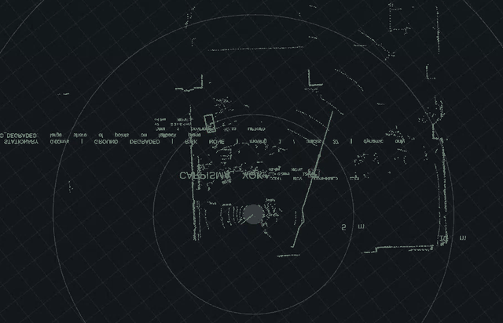
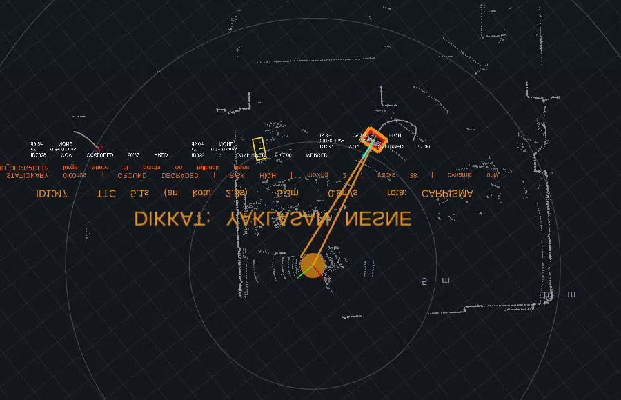
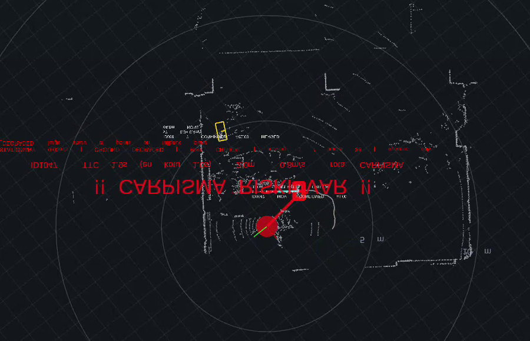
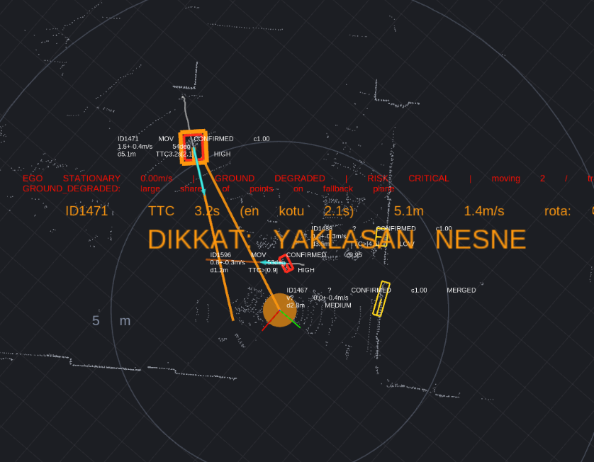
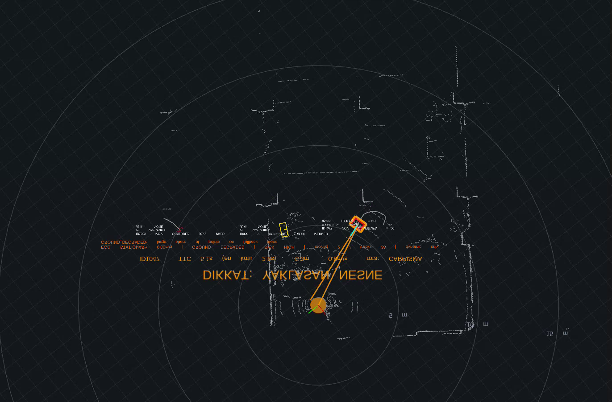
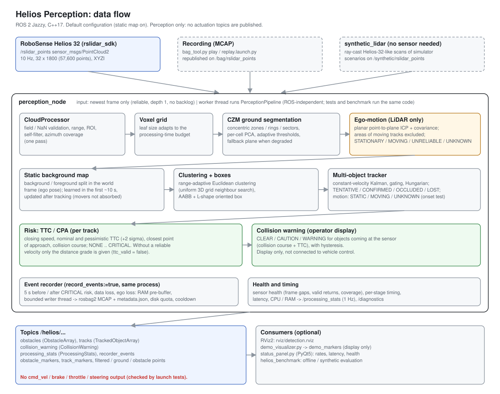

# Helios Perception

**Real-time LiDAR-only 3D perception and multi-object tracking for the RoboSense Helios 32 (ROS 2 Jazzy, C++17)**

[](https://github.com/yagizkaras06/helios-perception/actions/workflows/ci.yml)
&nbsp;License: Apache-2.0 &nbsp;|&nbsp; [Türkçe](README.tr.md)

Helios Perception turns the raw point cloud of a single 32-beam LiDAR into tracked obstacles with
velocity, motion state, time-to-collision and an operator collision warning. It runs on real
hardware at the sensor rate (10 Hz) and uses no camera, GPS, IMU or wheel odometry: ego-motion
is also estimated from the LiDAR alone. Every estimate carries its uncertainty, and estimates the
LiDAR cannot support are marked as unreliable or unknown, never presented as certain.

<p align="center">
  
  <br><sub>Live Helios 32, engineering RViz view, top-down, sensor at the filled circle, rings every 5 m.
  Full clip: <a href="assets/demo/demo.mp4">demo.mp4</a> (36 s). Labels are Turkish ASCII, see
  <a href="#demo-media">Demo media</a>.</sub>
</p>

| | |
|---|---|
| **Sensor** | RoboSense Helios 32 via [`rslidar_sdk`](https://github.com/RoboSense-LiDAR/rslidar_sdk), 10 Hz, 57,600 points per scan |
| **Measured live** | 9.96 Hz in / out, 0 frames dropped by the detector, 13.9 ms receive-to-publish mean (18.6 ms p95), 18 % of one CPU core |
| **Offline** | 4.6-5.9 ms per scan on real recordings (170-217 scans/s) |
| **Synthetic accuracy** | MOTA 0.82-1.00 over 7 ground-truth scenarios; no object that never moved was classified as moving |
| **Tests** | 94 test cases in 14 test programs: 10 gtest suites (unit, pipeline, system), 3 ROS launch tests, 1 pytest module (demo markers) |

Details and method: [doc/benchmarks.md](doc/benchmarks.md).

<a id="demo-media"></a>
| Approaching object: caution | Collision risk |
|---|---|
|  |  |
| **Two moving objects with velocity, heading and TTC** | **Scene overview (indoor lab, 5 / 10 / 15 m rings)** |
|  |  |

All media were captured on the live sensor in the engineering RViz profile (`rviz/detection.rviz`),
whose labels are Turkish ASCII: `DIKKAT: YAKLASAN NESNE` = *caution: approaching object*,
`CARPISMA RISKI VAR` = *collision risk*, `CARPISMA YOK` = *no collision risk*,
`TTC ... (en kotu ...)` = *TTC (worst case)*, `rota: CARPISMA` = *path: collision*. The images
are cropped to the 3D view and flipped horizontally: the recording used a mirrored RViz camera.
They are not edited otherwise. `github_demo.launch.py` provides an English presentation profile.

> **Perception only.** The stack publishes no `cmd_vel`, brake, throttle or steering command and
> is not connected to vehicle control; launch tests check this. Risk levels and the collision
> warning are information for an operator. This is not a safety-certified system.

## Contents

1. [What it does](#what-it-does)
2. [Architecture](#architecture)
3. [Quick start without a LiDAR](#quick-start-without-a-lidar)
4. [Installation](#installation)
5. [Running with a Helios 32](#running-with-a-helios-32)
6. [Recording, replay and event recording](#recording-replay-and-event-recording)
7. [Topics and messages](#topics-and-messages)
8. [Performance](#performance)
9. [Known limitations](#known-limitations)
10. [Repository layout, testing, roadmap, license](#repository-layout)

## What it does

| Stage | Method |
|---|---|
| Input | Newest scan only (reliable, depth 1): no backlog when processing is late; field / NaN validation, range, ROI, vehicle self-filter, azimuth coverage check |
| Ground | Concentric-zone (CZM) segmentation, inspired by Patchwork++: per-cell PCA planes, verticality / flatness / height / continuity tests, adaptive thresholds; status `RELIABLE / DEGRADED / FAILED` is reported |
| Ego-motion | Planar point-to-plane ICP on non-ground points, areas of moving tracks excluded, robust loss, hypothesis check against zero / constant motion; covariance and degeneracy; state `STATIONARY / MOVING / UNRELIABLE / UNKNOWN` |
| Static background | Voxel map in the odometry frame; space occupied for 10 s becomes background; updated after tracking so that people who stop are not absorbed |
| Objects | Range-adaptive Euclidean clustering (uniform 3D grid neighbour search), axis-aligned and L-shape oriented boxes |
| Tracking | Constant-velocity Kalman filter, chi-square gating, Hungarian assignment; lifecycle `TENTATIVE / CONFIRMED / OCCLUDED / LOST` with occlusion reasons and re-identification |
| Motion | Change-point onset test on the motion window plus point-surface consistency: `STATIC / MOVING / UNKNOWN`; velocity status `RELIABLE / UNRELIABLE / UNKNOWN` |
| Risk | Closing speed, nominal and pessimistic TTC (closing speed + 2 sigma), closest point of approach, collision course, level `NONE .. CRITICAL`; TTC only with a reliable velocity |
| Warning | `CLEAR / CAUTION / WARNING` for objects coming at the sensor, with hysteresis |
| Health | Frame gaps, time jumps, valid-return ratio, azimuth coverage, `NO_DATA`; per-stage timing, latency, CPU / RAM on `/processing_stats` and `/diagnostics` |
| Event recorder | Optional: 5 s before / after a critical risk, data loss or ego loss into rosbag2 (MCAP) with `metadata.json` |

## Architecture

<p align="center"></p>

The pipeline (`PerceptionPipeline`) has no ROS dependency: the ROS node, the tests and the
benchmark run the same code. The node publishes the primary outputs (`/tracks`, `/obstacles`)
first; markers and debug clouds are built on a separate thread and only when something
subscribes. Source files per stage are listed in [README.tr.md](README.tr.md#mimari).

## Quick start without a LiDAR

A ray-casting simulator of a Helios-32-like sensor ships with the package. It is the same one the
tests and the accuracy benchmark use. `synthetic_lidar` publishes its scans, so the whole stack
and the demo view run without hardware:

```bash
ros2 launch helios_obstacle_detection github_demo.launch.py mode:=synthetic scenario:=crossing status_panel:=true
```

Scenarios: `crossing`, `approach`, `ego_motion` (moving sensor), `occlusion`, `merge_split`,
`wall_walk`, `start_stop`. Accuracy against the simulator's ground truth:

```bash
ros2 run helios_obstacle_detection helios_benchmark synthetic --scenario all
```

The simulated world is simplified (flat ground, no intra-scan motion). It is meant for trying the
software and for regression tests, not as evidence of real-world accuracy.

## Installation

Requirements: Ubuntu 24.04, ROS 2 Jazzy. The LiDAR driver is not part of this repository.

```bash
mkdir -p ~/helios_ws/src && cd ~/helios_ws/src
git clone https://github.com/yagizkaras06/helios-perception.git helios_obstacle_detection
cd ~/helios_ws
source /opt/ros/jazzy/setup.bash
rosdep install --from-paths src --ignore-src -y --rosdistro jazzy
colcon build --packages-select helios_obstacle_detection --cmake-args -DCMAKE_BUILD_TYPE=Release
source install/setup.bash
```

## Running with a Helios 32

Start [`rslidar_sdk`](https://github.com/RoboSense-LiDAR/rslidar_sdk) as usual. It publishes
`sensor_msgs/PointCloud2` on `/rslidar_points`. Then:

```bash
ros2 launch helios_obstacle_detection detection.launch.py                     # detector
ros2 launch helios_obstacle_detection detection.launch.py rviz:=true          # + RViz2 (engineering view)
ros2 launch helios_obstacle_detection detection.launch.py record_events:=true # + event recorder, one process
ros2 launch helios_obstacle_detection github_demo.launch.py status_panel:=true  # presentation view on the running stack
ros2 run helios_obstacle_detection obstacle_report.py                         # live table in the terminal
```

Mounting is configured in [`config/detection.yaml`](config/detection.yaml). The values that
matter first are `ground.expected_height` (minus the mount height, currently -0.90 m),
`filter.self_filter` (vehicle body box) and `risk.ego_radius`. Different topic:
`input_topic:=/other_points`.

Notes from the development setup (unsynchronised sensor clock, the desk next to the sensor, ROS
discovery on a shared Wi-Fi network): [doc/field_notes.md](doc/field_notes.md). If other ROS 2
machines share the network, `export ROS_AUTOMATIC_DISCOVERY_RANGE=LOCALHOST` keeps discovery on the
local host.

## Recording, replay and event recording

`scripts/bag_tool.py` records and plays MCAP with `rosbag2_py`.

```bash
ros2 run helios_obstacle_detection bag_tool.py record -o my_run --preset perception --duration 60
ros2 launch helios_obstacle_detection replay.launch.py bag:=my_run rviz:=true loop:=true
ros2 launch helios_obstacle_detection github_demo.launch.py mode:=replay bag:=my_run status_panel:=true
```

Replay publishes on `/bag/rslidar_points` and runs its own detector in the `/helios_bag`
namespace, so it can run next to a live system.

With `record_events:=true`, the event recorder keeps a RAM pre-buffer. On a CRITICAL risk, a data
loss or a loss of the ego estimate, it writes 5 s before and 5 s after the event (raw scan, tracks,
markers, warning, statistics) with `metadata.json`. The metadata holds the trigger, the window
actually covered, integrity counters and the effective parameters. Disk quota, per-event limit and
a per-trigger cooldown keep it bounded. Events replay with
`replay.launch.py bag:=<event>/bag [mode:=recorded]`.

## Topics and messages

Default namespace `helios`. All outputs keep the input header (stamp and `frame_id`).

| Topic | Type | Content |
|---|---|---|
| `/rslidar_points` (input) | `sensor_msgs/PointCloud2` | from the driver |
| `/helios/tracks` | `TrackedObjectArray` | main output: persistent id, box, velocity +- sigma, heading, motion and lifecycle state, TTC / CPA, risk, ego-motion state |
| `/helios/obstacles` | `ObstacleArray` | per-scan detections (axis-aligned and oriented boxes) |
| `/helios/collision_warning` | `CollisionWarning` | `CLEAR / CAUTION / WARNING`, threat track, TTC, distance |
| `/helios/processing_stats` | `ProcessingStats` | 1 Hz: rates, drops, latency, stage timing, CPU / RAM, ground / ego / tracking state |
| `/helios/track_markers`, `/helios/obstacle_markers` | `visualization_msgs/MarkerArray` | RViz |
| `/helios/filtered_points`, `ground_points`, `obstacle_points`, `obstacle_clusters` | `PointCloud2` | debug clouds (only with subscribers) |
| `/helios/recorder_events` | `std_msgs/String` (JSON) | event recorder start / merge / end |
| `/diagnostics` | `diagnostic_msgs/DiagnosticArray` | input, scan quality, time sync, processing, ground, ego-motion, tracking, recorder |

Message definitions with field comments: [`msg/`](msg/).

## Performance

Measured on an Intel i7-13620H laptop. Full tables, scenario descriptions and method:
[doc/benchmarks.md](doc/benchmarks.md).

| Live sensor (817 s) | |
|---|---|
| Input / output | 9.96 / 9.96 Hz; 8,145 frames received, 8,145 processed, 0 dropped by the detector |
| Pipeline per frame | 13.7 ms mean, 18.4 ms p95 |
| Receive to `/tracks` | 13.9 ms mean, 18.6 ms p95, 31.3 ms max |
| CPU / RAM | 17.9 % of one core, 139-163 MB (with event recorder) |

| Synthetic (ground truth) | MOTA | IDF1 | Velocity RMSE |
|---|---|---|---|
| Still sensor, pedestrians and cars | 0.837 | 0.906 | 0.17 m/s |
| Sensor at 3 m/s with a turn, 40 obstacles | 0.823 | 0.813 | 0.29 m/s |
| Object driving at the sensor (TTC MAE 0.02 s) | 0.992 | 0.996 | 0.02 m/s |
| Occlusions 0.5-2.5 s | 0.966 | 0.983 | 0.09 m/s |

Sensor-to-host latency cannot be measured here: the Helios clock is not synchronised (no PTP / GPS).
The node detects this and reports delivery jitter instead.

## Known limitations

* **Accuracy on real data is not measured.** The recordings have no labels, so they are used for
  timing and consistency only. Accuracy numbers come from a simplified simulator and are an upper
  bound.
* **Tested with a stationary sensor.** Live tests were indoors with the sensor on a desk. Moving-sensor
  behaviour has only been evaluated in simulation.
* **LiDAR-only ego-motion is planar** (x, y, yaw) and has no intra-scan deskew. At 10 m/s a scan
  smears by ~1 m. In degenerate scenes (long corridor, open field, sparse returns) the state becomes
  `UNRELIABLE` / `UNKNOWN` and motion classes fall back to `UNKNOWN`.
* **TTC is computed against a circle around the sensor** (`risk.ego_radius`), assuming constant
  relative velocity. The vehicle footprint is not modelled.
* **Box centres are the centres of the visible part.** Occlusion and viewpoint changes shift them.
  This is modelled in the measurement noise but cannot be removed.
* **No object classes** (pedestrian / vehicle).
* **Track identity after occlusion.** Re-association to a different nearby small object was
  observed on live data, and short-lived tentative tracks are frequent in cluttered indoor scenes.
* **Indoors the ground is often `DEGRADED`.** Little floor is visible from a desk-mounted sensor,
  and a fallback plane is used. This is reported in `/processing_stats`.
* **Input gaps upstream of this package.** On the development setup, scans went missing at the
  driver output after Ethernet link interruptions, while the network interface still received the
  full packet rate. Restarting the driver restored 10 Hz. The detector reports such gaps
  (`SENSOR_DEGRADED` / `NO_DATA`) but cannot repair them.
* The engineering RViz profile (`rviz/detection.rviz`) labels its collision banner in Turkish ASCII.
  The demo profile is English by default (`language:=en|tr`).

<a id="repository-layout"></a>
## Repository layout, testing, roadmap, license

```
src/, include/     pipeline, ROS node, event recorder, synthetic sensor, benchmark
msg/               ObstacleArray, TrackedObjectArray, CollisionWarning, ProcessingStats
launch/            detection, replay, github_demo
config/            detection.yaml (all parameters, commented), RViz demo profile
scripts/           bag_tool, demo_visualizer, status_panel, obstacle_report, perf_report
test/              gtest suites, launch tests, demo marker tests
tools/             evaluation scripts (pseudo ground truth), diagram generator
doc/               benchmarks, field notes, earlier reports
assets/            demo media, architecture diagram
```

```bash
ROS_DOMAIN_ID=77 colcon test --packages-select helios_obstacle_detection
colcon test-result --test-result-base build/helios_obstacle_detection --verbose
```

The tests cover:
* Hungarian against brute force, and Kalman filter consistency.
* Tracking through crossings, occlusions and merges.
* Ego-motion on still, moving and degenerate scenes.
* Ground segmentation on slopes, tables and failure cases.
* TTC and risk, sensor health, and the thread pool.
* End-to-end system tests on simulated scans, and the event recorder.
* Demo markers: no blank text, no stale markers.
* Absence of actuation topics in the ROS graph.

Next version: [ROADMAP.md](ROADMAP.md). Changes: [CHANGELOG.rst](CHANGELOG.rst).
Licensed under the [Apache License 2.0](LICENSE). RoboSense and Helios are trademarks of their
owner. This project is not affiliated with RoboSense.
